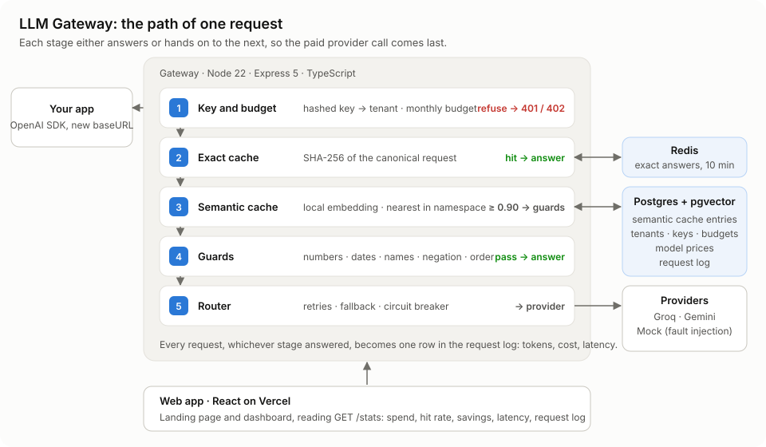
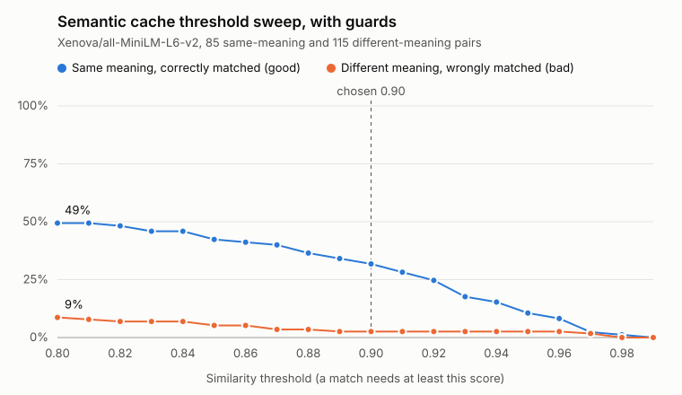

# LLM Gateway

An OpenAI-compatible gateway that sits between an application and its LLM providers. Apps change one line, their `baseURL`, and in return get answers to repeated **and reworded** questions served from cache, automatic fallback when a provider fails, per-tenant budgets, and the cost of every token recorded.

## Headline result

On a 50-request mixed workload sent through the gateway to Groq:

| | |
| --- | --- |
| **Served from cache** | **56%** of cacheable requests (25 of 45): 15 exact repeats, 10 reworded questions |
| **Spend** | **50% lower**: 909 micro-dollars paid against 1,836 without the cache |
| **Speed** | **13× faster** on a cache hit: 56 ms median for an exact hit, 141 ms for a semantic hit, 718 ms when the provider answers |
| **Wrong cached answers** | cut **from 30 to 3** by the semantic guards, measured on 200 hand-labelled question pairs |

The workload was written to contain repeats and rewordings (20 new questions, 15 repeats, 10 rewordings, 5 deliberately uncacheable), so the hit rate shows what the cache *can* do rather than a forecast for real traffic. Costs are worked out from the providers' list prices. The amounts are tiny because the model used is cheap; the 50% is the part that scales.

## How a request flows



Each stage either answers or hands on to the next, so the paid provider call happens only when nothing cheaper can answer:

1. **Key and budget.** API keys are stored as SHA-256 hashes. A tenant over its monthly budget gets a 402 before anything is spent.
2. **Exact cache.** The request is rewritten into one canonical form (sorted keys, trimmed content, every answer-changing field included) and hashed. Redis answers identical requests.
3. **Semantic cache.** The question is turned into 384 numbers by an embedding model running inside the gateway, and pgvector finds the closest question already answered under the same setup.
4. **Guards.** A close match must still agree on numbers, dates, names, negation and word order before its answer is trusted.
5. **Router.** Retries with doubling, jittered waits, falls back to the next provider, and skips a provider that is down using a circuit breaker.

Every request becomes one row in the request log, with tokens, cost in micro-dollars, latency and time to first token. A React dashboard reads it back.

## Why the caching is not trivial

An exact cache is easy: same bytes in, same answer out. Matching by *meaning* is where it gets hard, because a confident wrong answer is far worse than a slow right one. Three problems had to be solved.

### 1. A similar question can deserve a different answer

"Tell me more" means something different in a chat about cats and in a chat about taxes. "Summarise this" means something different under two different system prompts. So questions are only ever compared within a **namespace**: a hash of the tenant, model, system prompt, tool definitions, temperature band, the earlier conversation and every other setting. Only when all of that matches exactly does meaning get compared at all.

### 2. No similarity threshold is safe on its own

The usual advice is to treat anything above about 0.95 cosine similarity as the same question. I tested that instead of trusting it: 200 question pairs labelled by hand as "same meaning" or "different meaning", with 94 of them written to be hard (one changed number, a "not", a swapped name or date), swept across every threshold from 0.80 to 0.99.


What came out:

- **0.95 was a bad guess for this model.** It caught only 13% of genuine rewordings and still let 18 wrong matches through.
- **Raising the threshold makes things worse, not safer.** Above 0.94 the wrong matches outnumber the right ones, because the most dangerous pairs score *higher* than real rewordings do. To this model, a sentence is mostly the set of things it mentions; word order and a single "not" barely move it.
- **I chose 0.90**, the lowest threshold at which every wrong match is a near-identical question differing by one word, number, name or date. Below 0.89, whole different questions on the same topic start matching ("How long does shipping take?" / "How much does shipping cost?" scored 0.884), and no cheap check can catch those.

Full table and reasoning: [evals/results.md](evals/results.md).

### 3. The wrong matches, and how the guards handle them

At 0.90 the embedding alone serves 30 wrong answers out of 115 different-meaning pairs. These are the highest-scoring ones, and what now happens to them:

| Score | Pair | Guard verdict |
| --- | --- | --- |
| 0.992 | How do I convert a **string to a number** / a **number to a string** in JavaScript? | refused: direction swapped |
| 0.989 | Find flights from **London to Paris** / from **Paris to London** | refused: names in a different order |
| 0.984 | Is it **legal** / **illegal** to record a phone call without consent? | refused: opposite meaning (legal vs illegal) |
| 0.972 | Why is my code **working** / **not working**? | refused: one side is negated |
| 0.969 | Schedule the meeting for **next week** / **this week** | refused: dates differ |
| 0.936 | Give me **3** / **10** ideas for a birthday party | refused: numbers differ |

The guards are plain text checks that take about 50 microseconds per comparison. Number words count as digits, so "15%" and "fifteen percent" still match. The minimum word overlap was measured too: 0.4 removes two more wrong matches for the cost of three right ones, and since a wrong answer is worse than a miss, 0.4 it is.



| At 0.90 | Rewordings caught | Wrong matches | Hits that were right |
| --- | --- | --- | --- |
| Embeddings only | 33 of 85 | 30 of 115 | 52% |
| Embeddings + guards | 27 of 85 | 3 of 115 | 90% |

**What still gets through:** "Is a whale bigger than an elephant?" and its reverse (0.979), "formal" / "casual" apology email (0.976), "zoom in" / "zoom out" (0.961). Each differs only by words that are opposite in meaning, and nothing in the text says so.

**What the guards wrongly refuse:** "JS" against "JavaScript" (looks like a different name), "largest ocean" against "biggest ocean" (too few shared words), and "explain like I'm five" against "explain simply" ("five" reads as a number). Those cost a provider call, not a wrong answer.

## Running it locally

You need Node 22 or newer, Docker Desktop, and free API keys from [Groq](https://console.groq.com) and [Google AI Studio](https://aistudio.google.com) (Gemini). The mock provider works without any key.

```
git clone https://github.com/NishaM2/LLM-Gateway.git
cd LLM-Gateway
npm install
cp .env.example .env               # then fill in GROQ_API_KEY and GEMINI_API_KEY
docker compose up -d --wait        # Postgres with pgvector on 5433, Redis on 6379
npm run db:migrate
npm run tenant:create -- "My App" 1.00    # prints an API key once, save it
npm run dev                        # the gateway on http://localhost:3000
```

Send a request with the key you just saved. The `mock` model answers instantly and costs nothing; use `fast` to go to Groq:

```
curl http://localhost:3000/v1/chat/completions \
  -H "Authorization: Bearer YOUR_KEY" -H "Content-Type: application/json" \
  -d '{"model": "mock", "messages": [{"role": "user", "content": "Why is the sky blue?"}]}'
```

On Windows PowerShell, put the body in a file and use `curl.exe ... -d "@body.json"`, because PowerShell strips the quotes from inline JSON.

The landing page and dashboard:

```
npm run web:install    # once
npm run web            # http://localhost:5173, with the gateway still running
npm run traffic -- YOUR_KEY    # optional: 50 mixed requests so the charts have something to show
```

| Command | What it does |
| --- | --- |
| `npm test` | 79 unit tests (Node's built-in runner) |
| `npm run eval:sweep` | re-runs the threshold sweep on the 200 labelled pairs and redraws the chart |
| `npm run eval:sweep:guards` | the same with the guards switched on |
| `npm run semantic:check` | checks hit counting, expiry, cleanup and namespace flushing against the real database |
| `npm run cache:flush -- "Tenant" request.json` | clears every cached answer for one setup |
| `npm run embeddings:check` | shows the similarity scores for three example sentences |

## Deploying

The demo runs entirely on free tiers: the web app on **Vercel**, the gateway on **Render** (`render.yaml`), Postgres with pgvector on **Neon**, and Redis on **Upstash**. Vercel forwards `/v1`, `/stats` and `/health` to Render (`client/vercel.json`), so the browser only ever talks to one address. Step-by-step instructions are in [docs/design.md](docs/design.md#deploying-for-free).

## Known limitations

These are real, and most are deliberate trade-offs rather than oversights.

**Caching**

- **Embeddings add work to every cacheable miss.** Before a miss reaches the provider it pays for an exact-cache lookup, an embedding (about 13 ms) and a vector search. The gap between the exact-hit and semantic-hit medians (56 ms and 141 ms) suggests the semantic step costs roughly 85 ms. Running the model locally keeps that free of charge, but it costs CPU, memory and a 23 MB model download on every restart. With a hosted embedding API it would also cost money on every miss, cancelling some of the savings.
- **The semantic cache is not perfect.** 3 of 115 different-meaning pairs still match at 0.90, and 6 genuine rewordings are refused. Closing the first gap needs a second model that reads both questions together, at the cost of a call per candidate hit.
- **The evaluation set is small and one-sided.** 200 pairs is enough to see the shape of the trade-off, not to pin the threshold to two decimal places, and every label was written by one person. Nearly half the pairs are deliberate traps, so the "hits that were right" figure is a worst case.
- **The threshold belongs to this embedding model.** Another model scores on a different scale and needs a fresh sweep before its threshold means anything.
- **The caches hold question and answer text.** The request log never stores prompts or replies, but the exact cache keeps answers for 10 minutes and the semantic cache keeps questions and answers for an hour.
- **A new answer becomes findable a few milliseconds after it is sent**, because it is saved once the reply is on its way. A rewording arriving inside that window is a miss.

**Routing**

- **Fallback is impossible once streaming has started.** The router can only switch providers before the first byte reaches the client. If a provider dies mid-answer, the client gets a truncated answer recorded as `stream_broken`, because switching providers halfway would glue two different answers together.
- **Circuit breaker state lives in memory.** It is lost on restart, and several gateway processes would each learn about an outage separately. Sharing it would mean keeping the counters in Redis.
- **A long rate-limit delay is still retried.** Gemini's quota errors say how long to wait, sometimes hours, and the gateway retries anyway, wasting two calls.
- **A provider that hangs can hold a request for up to 90 seconds** (30 seconds per attempt, three attempts) before the circuit breaker starts skipping it.

**Budgets**

- **The budget check has a race.** Spend is summed before each request, so two requests arriving together can both read the same total and both be allowed. A tenant can overshoot slightly. Fixing it properly needs a reservation or a lock per tenant.
- **The request that crosses the limit still succeeds.** Cost is only known once the provider replies, so the block applies from the next request.

**Hosting**

- **Free tiers sleep.** Render stops after 15 minutes without traffic and takes about a minute to wake, and Neon pauses after 5 minutes. An uptime monitor on `/health` keeps the gateway awake, but the first request after a quiet spell can still be slow.
- **The public demo dashboard is open.** `STATS_PUBLIC=true` lets anyone read the stats, including tenant names. That is fine for demo data and wrong for anything else.

## Where to look next

- [docs/design.md](docs/design.md): how every part behaves and why, from cache keys to the circuit breaker
- [evals/results.md](evals/results.md): the full threshold study, with every row of the sweep
- [evals/pairs.json](evals/pairs.json): the 200 labelled pairs
