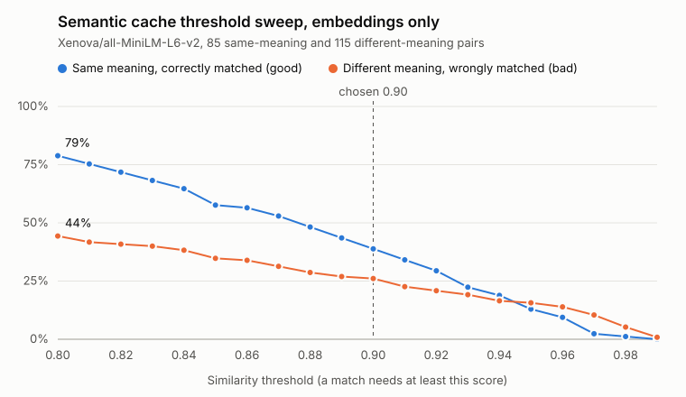

# Semantic cache threshold: results

**Decision: 0.90.** It is the lowest threshold at which every wrong match is a near-identical question that differs by a single word, number, name or date, which is exactly what the Step 34 guards are built to catch. At the same time it catches three times as many genuine rewordings as the 0.95 starting guess.

## Setup

- Model: `Xenova/all-MiniLM-L6-v2`, run locally, 384 dimensions
- Data: [pairs.json](pairs.json), 200 labelled pairs. 85 have the same meaning (25 of them hard: typos, slang, very different wording) and 115 have different meanings (69 of them hard: one number, negation, name, date, direction, opposite word or format changed)
- A pair counts as matched when its cosine similarity is at or above the threshold
- Reproduce with `npm run eval:sweep`. The model is deterministic, so the numbers come out the same every time

## Results

| Threshold | Same caught | Different wrongly matched | Hits that were right | Wrong matches by kind |
| --- | --- | --- | --- | --- |
| 0.80 | 67 (79%) | 51 (44%) | 57% | number 13, negation 11, order 7, opposite 7, date 6, related 3, format 3, name 1 |
| 0.81 | 64 (75%) | 48 (42%) | 57% | number 12, negation 11, order 7, opposite 7, date 6, format 3, related 2 |
| 0.82 | 61 (72%) | 47 (41%) | 56% | number 12, negation 11, order 7, opposite 7, date 6, related 2, format 2 |
| 0.83 | 58 (68%) | 46 (40%) | 56% | number 12, negation 11, order 7, opposite 7, date 5, related 2, format 2 |
| 0.84 | 55 (65%) | 44 (38%) | 56% | number 11, negation 11, order 7, opposite 7, date 4, related 2, format 2 |
| 0.85 | 49 (58%) | 40 (35%) | 55% | negation 11, number 10, order 7, opposite 5, date 4, format 2, related 1 |
| 0.86 | 48 (56%) | 39 (34%) | 55% | negation 11, number 9, order 7, opposite 5, date 4, format 2, related 1 |
| 0.87 | 45 (53%) | 36 (31%) | 56% | negation 11, number 8, order 7, date 4, opposite 3, format 2, related 1 |
| 0.88 | 41 (48%) | 33 (29%) | 55% | negation 10, number 7, order 7, date 4, opposite 2, format 2, related 1 |
| 0.89 | 37 (44%) | 31 (27%) | 54% | negation 9, number 7, order 7, date 4, opposite 2, format 2 |
| **0.90 (chosen)** | **33 (39%)** | **30 (26%)** | **52%** | negation 9, order 7, number 6, date 4, opposite 2, format 2 |
| 0.91 | 29 (34%) | 26 (23%) | 53% | negation 8, order 7, date 4, number 3, opposite 2, format 2 |
| 0.92 | 25 (29%) | 24 (21%) | 51% | negation 8, order 7, date 4, number 3, opposite 1, format 1 |
| 0.93 | 19 (22%) | 22 (19%) | 46% | negation 8, order 7, date 3, number 2, opposite 1, format 1 |
| 0.94 | 16 (19%) | 19 (17%) | 46% | negation 8, order 7, date 2, opposite 1, format 1 |
| 0.95 | 11 (13%) | 18 (16%) | 38% | negation 7, order 7, date 2, opposite 1, format 1 |
| 0.96 | 8 (9%) | 16 (14%) | 33% | order 7, negation 5, date 2, opposite 1, format 1 |
| 0.97 | 2 (2%) | 12 (10%) | 14% | order 7, negation 4, format 1 |
| 0.98 | 1 (1%) | 6 (5%) | 14% | order 5, negation 1 |
| 0.99 | 0 (0%) | 1 (1%) | 0% | order 1 |

## What the numbers say

**No threshold is safe on its own.** At every setting, roughly half or more of the hits are wrong answers. Raising the threshold does not fix this, it makes it *worse*: above 0.94 the wrong matches outnumber the right ones, because the most dangerous pairs score higher than real rewordings do.

**The embedding barely notices one changed word.** The highest-scoring wrong matches:

| Score | Pair | Kind |
| --- | --- | --- |
| 0.992 | convert a **string to a number** / a **number to a string** in JavaScript | order |
| 0.989 | flights from **London to Paris** / from **Paris to London** | order |
| 0.984 | is it **legal** / **illegal** to record a call without consent | negation |
| 0.976 | write a **formal** / **casual** apology email | format |
| 0.975 | return an item that **has** / **hasn't** been opened | negation |

To this model, a sentence is mostly the bag of things it is about. Word order and a single "not" hardly move the vector.

**Real rewordings often score low.** "my package hasnt arrived yet whats going on" and "My order is late. Where is it?" mean the same thing but score only 0.471. Casual, typo-ridden questions are the ones a cache would most like to catch, and they are the hardest to catch.

**Questions on the same topic but asking something else** ("How long does shipping take?" / "How much does shipping cost?") top out at 0.884. That is why 0.90 is the floor: at 0.89 and above, none of them match.

## Why 0.90

The choice is made knowing that a wrong answer is far worse than a miss. A miss costs one provider call. A wrong answer is served confidently and the user has no way of telling.

- **Below 0.89**, the wrong matches include whole different questions on the same topic. No cheap check can catch those, because the two questions share most of their words.
- **At 0.90**, every wrong match is a one-word or one-number trap. Numbers, dates and names can be compared exactly, and negations and word order can be checked cheaply. That is the job of Step 34.
- **Above 0.90**, real hits fall away fast (13% at 0.95, 2% at 0.97) while the worst traps remain, so a higher threshold buys almost no safety.

**This threshold is only acceptable together with the Step 34 guards.** On its own, 0.90 serves 30 wrong answers in this set. Until the guards are in place, the semantic cache should not be trusted.

## Caveats

- The set is deliberately adversarial. 60% of the different-meaning pairs are traps, far more than real traffic would contain, so the "hits that were right" column is a worst case rather than a forecast.
- 200 pairs is enough to see the shape of the trade-off, but not to pin the threshold to two decimal places. One pair moving changes a row by about 1%.
- The labels are judgement calls, made by one person. Different labels on borderline pairs would shift the numbers slightly.
- All of this is specific to `all-MiniLM-L6-v2`. A different embedding model needs a fresh sweep, because its scores sit on a different scale (an early check of `bge-small-en-v1.5` scored even unrelated questions around 0.35).
